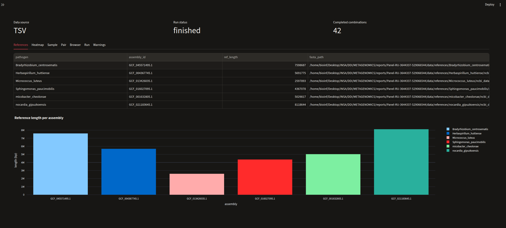
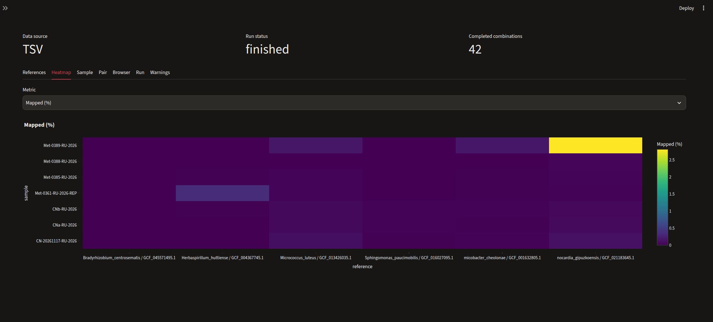
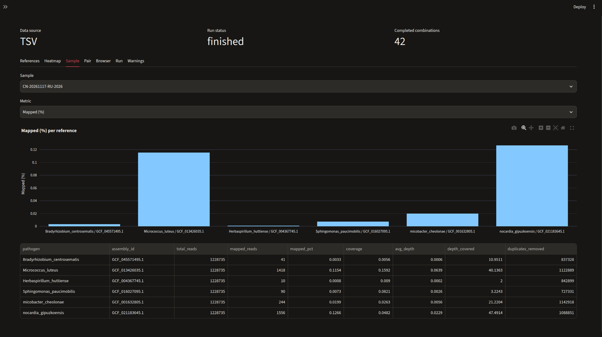
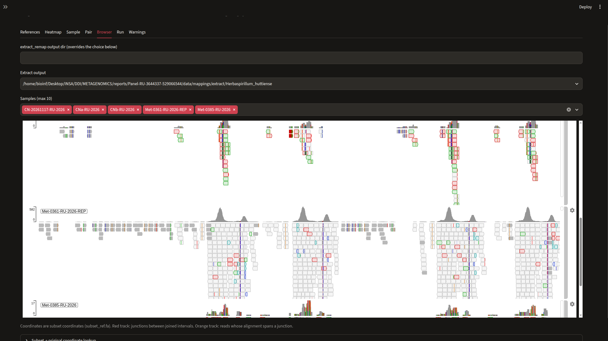

# mapping_tracker — metagenomics mapping and results dashboard


Maps metagenomics samples against reference genomes with **BWA-MEM** (default) or **minimap2** (`--aligner minimap2`), removes duplicate reads with **Picard MarkDuplicates**, filters alignments for length/identity with **msamtools**, and produces per-combination alignment statistics. Reads are optionally trimmed of low-quality bases with **Trimmomatic** before mapping (on by default), then cleaned of low-complexity/low-entropy sequence with **prinseq++**, which removes the high-GC artifacts that otherwise map spuriously. For **Nanopore** long-read data use `--nanopore`: reads are quality/length-filtered with **NanoFilt** and mapped as single-end with **minimap2 `-ax map-ont`**, then cleaned of low-complexity/low-entropy sequence with **prinseq++** (disable with `--no-prefilter`). The script auto-detects both directory layouts and paired-end conventions, so the same invocation works across all supported data arrangements.

## Supported layouts

References and samples are detected automatically — no layout flags needed.

### References

| Layout      | Structure                                                         | Pathogen / Assembly                                                                                                   |
| ----------- | ----------------------------------------------------------------- | --------------------------------------------------------------------------------------------------------------------- |
| Nested NCBI | `references/<pathogen>/ncbi_dataset/data/{GCF_,GCA_}*/<file>.fna` | pathogen = dir name, assembly = accession dir. RefSeq (`GCF_`) preferred; GenBank (`GCA_`) used when no `GCF_` exists |
| Flat        | `references/*.fa`, `references/*.fasta` (optionally `*.fa.ref`)   | pathogen = first `_`-token of filename, assembly = full stem                                                          |

### Samples

| Layout | Structure                                            | Paired detection                                                      |
| ------ | ---------------------------------------------------- | --------------------------------------------------------------------- |
| Flat   | `samples/*.fastq.gz` side by side                    | `_R1`/`_R2`, `_R1_001`/`_R2_001`, `_1P`/`_2P`, `_1`/`_2`, `.R1`/`.R2` |
| Nested | `samples/<sample>/*_R1*.fastq.gz` (+ optional `_R2`) | per-sample directory                                                  |

Sample names have read markers stripped (e.g. `JPG10-..._S10_L001_R2_001` → `JPG10-..._S10_L001`). Unpaired files are treated as single-end.

In nanopore mode (`--nanopore`) reads are single-end long reads: every FASTQ becomes its own sample and no read-pairing is attempted.

## Usage

Basic run:

```bash
python map_references.py \
  --refs-dir Panel-RUV-3643814/data/references \
  --samples-dir Panel-RUV-3643814/data/samples \
  --output mapping_statistics.tsv \
  --output-dir mapping_results
```

### Screenshots









The app is read-only for the other tabs. The Run tab is the only place that starts pipeline work, and it writes only into the output dir (see below).

### Options

| Flag                    | Default                                         | Description                                                                                                                                                |
| ----------------------- | ----------------------------------------------- | ---------------------------------------------------------------------------------------------------------------------------------------------------------- |
| `--refs-dir`            | `references`                                    | Directory containing reference genomes                                                                                                                     |
| `--samples-dir`         | `.`                                             | Directory containing sample FASTQs                                                                                                                         |
| `--output`              | `mapping_statistics.tsv`                        | Output TSV path                                                                                                                                            |
| `--output-dir`          | `mapping_results`                               | BAM output directory                                                                                                                                       |
| `--workers`             | `4`                                             | Number of parallel workers                                                                                                                                 |
| `--threads`             | `os.cpu_count()`                                | Total threads across all workers                                                                                                                           |
| `--verbose`, `-v`       | off                                             | Debug logging                                                                                                                                              |
| `--log-file`            | `mapping_log.txt`                               | Log file path                                                                                                                                              |
| `--msamtools`           | `msamtools` on `PATH` (`MAPPING_MSAMTOOLS`)     | Path to msamtools binary                                                                                                                                   |
| `--min-len`             | `100`                                           | Minimum alignment length (bp)                                                                                                                              |
| `--min-identity`        | `0.98`                                          | Minimum sequence identity (0–1)                                                                                                                            |
| `--min-query-aligned`   | `0.50`                                          | Minimum fraction of the query aligned (0–1)                                                                                                                |
| `--no-filter`           | off                                             | Disable msamtools filtering                                                                                                                                |
| `--prinseq`             | `prinseq++` on `PATH` (`MAPPING_PRINSEQ`)       | Path to prinseq++ binary                                                                                                                                   |
| `--no-prefilter`        | off                                             | Disable prinseq++ read prefiltering                                                                                                                        |
| `--min-entropy`         | `0.5`                                           | Minimum sequence entropy (0–1) for prefilter                                                                                                               |
| `--min-dust`            | `0.5`                                           | Minimum dust score (0–1) for prefilter                                                                                                                     |
| `--prefilter-gz`        | off                                             | Write prefiltered FASTQs gzip-compressed                                                                                                                   |
| `--picard`              | `picard` on `PATH` (`MAPPING_PICARD`)           | Path to picard binary                                                                                                                                      |
| `--no-dedup`            | off                                             | Disable Picard duplicate removal                                                                                                                           |
| `--dedup-heap`          | `8g` (`MAPPING_DEDUP_HEAP`)                     | JVM heap for MarkDuplicates (e.g. `4g`)                                                                                                                    |
| `--aligner`             | `bwa`                                           | Aligner: `bwa` (`bwa mem`), `minimap2` (`-ax sr`, `--secondary=no`; `-ax map-ont` under `--nanopore`), or a full path to the binary (detected by basename) |
| `--trimmomatic`         | `trimmomatic` on `PATH` (`MAPPING_TRIMMOMATIC`) | Path to trimmomatic binary                                                                                                                                 |
| `--no-trim`             | off                                             | Disable Trimmomatic read trimming                                                                                                                          |
| `--trim-phred`          | `33`                                            | Phred offset for trimming (33 or 64)                                                                                                                       |
| `--trim-leading`        | `3`                                             | Trim bases below this quality from the start                                                                                                               |
| `--trim-trailing`       | `3`                                             | Trim bases below this quality from the end                                                                                                                 |
| `--trim-minlen`         | `36`                                            | Drop reads shorter than this after trimming                                                                                                                |
| `--trim-sliding-window` | `5:20`                                          | Trimmomatic sliding window `WINDOW:QUAL`                                                                                                                   |
| `--nanopore`            | off                                             | Nanopore long-read mode: NanoFilt QC, single-end reads, minimap2 `-ax map-ont`                                                                             |
| `--nanofilt`            | `NanoFilt` on `PATH` (`MAPPING_NANOFILT`)       | Path to NanoFilt binary                                                                                                                                    |
| `--nanofilt-quality`    | `7`                                             | Minimum average read quality for NanoFilt                                                                                                                  |
| `--nanofilt-minlen`     | `200`                                           | Minimum read length for NanoFilt                                                                                                                           |
| `--nanofilt-headcrop`   | `0`                                             | Trim n bases from the start of each read (0 disables)                                                                                                      |
| `--nanofilt-tailcrop`   | `0`                                             | Trim n bases from the end of each read (0 disables)                                                                                                        |

Tool locations default to `PATH` and can be overridden with `MAPPING_BWA`, `MAPPING_MINIMAP2`, `MAPPING_SAMTOOLS`, `MAPPING_MSAMTOOLS`, `MAPPING_PRINSEQ`, `MAPPING_PICARD`, `MAPPING_TRIMMOMATIC`, and `MAPPING_NANOFILT`.

Each worker uses `--threads // --workers` threads for `bwa mem`/`minimap2` and `samtools sort`, avoiding CPU oversubscription.

## Requirements

- Python 3 with `pandas` (`pip install pandas`)
- `bwa` and `samtools` (>= 1.13) available in `PATH`
- `minimap2` available in `PATH` — only when using `--aligner minimap2` (or pass a full path to the minimap2 binary with `--aligner`)
- `trimmomatic` (e.g. conda env `/home/bioinf/miniconda3/envs/map_reference`, requires Java) — required for read trimming (on by default); override with `--trimmomatic`, or skip with `--no-trim`
- `msamtools` (e.g. conda env `/home/bioinf/miniforge3/envs/msamtools`) — required for filtering; override with `--msamtools`, or skip with `--no-filter`
- `prinseq++` (e.g. conda env `/home/bioinf/miniforge3/envs/peproc`) — required for read prefiltering (on by default); override with `--prinseq`, or skip with `--no-prefilter`
- `picard` (e.g. conda env `/home/bioinf/miniconda3/envs/picard`) — required for duplicate removal (on by default); override with `--picard`, or skip with `--no-dedup`
- `NanoFilt` (e.g. conda env `/home/bioinf/miniconda3/envs/map_reference`) — required only with `--nanopore`; override with `--nanofilt`

## Read trimming

By default every sample is trimmed with **Trimmomatic** before mapping (quality trimming):

```bash
trimmomatic PE -threads <n> -phred33 <R1> <R2> <out1> <out2> <unpaired1> <unpaired2> \
  LEADING:3 TRAILING:3 SLIDINGWINDOW:5:20 MINLEN:36
```

Single-end samples use `trimmomatic SE` with one input/output. Trimming runs once per sample (not per combination). Trimmed paired reads are written to `<output-dir>/trimmed/<sample>_R1.fq` / `_R2.fq`; paired reads whose mate failed trimming survive as single-end reads in `<sample>_R1.single.fq` / `<sample>_R2.single.fq` and are mapped as single-end groups. A `<sample>.trimmed` marker records the trimming parameters used, so a re-run with unchanged settings reuses the cached reads; changing any `--trim-*` option (or the input FASTQs) re-trims. When trimming is enabled, its parameters are also part of the prefilter cache key, so re-trimming invalidates the cached prinseq++ outputs. The number of reads removed per sample is reported in the log. Use `--no-trim` to disable trimming entirely.

## Read prefiltering

By default every sample is cleaned with `prinseq++` before mapping, removing low-complexity / low-entropy reads (a common source of spurious high-GC mappings):

```bash
prinseq++ -threads <n> -fastq <R1> [-fastq2 <R2>] \
  -lc_entropy <min-entropy> -lc_dust <min-dust> \
  -out_good ... -out_good2 ... -out_single ... -out_single2 ... -out_bad /dev/null -out_bad2 /dev/null
```

Prefiltering runs once per sample (not per combination). Passing reads are written to `<output-dir>/prefiltered/` as `<sample>_R1.fq`, `<sample>_R2.fq` (good pairs) plus `<sample>_R1.single.fq` / `<sample>_R2.single.fq` (orphans whose mate failed); orphans are mapped as single-end and merged with the paired BAM. Single-end reads carried over from trimming are filtered as single-end inputs too (`<sample>_s0.fq`, `_s1.fq`, ...). A `<sample>.prefiltered` marker records the parameters used, so a re-run with unchanged settings reuses the cached reads. Changing `--min-entropy`, `--min-dust`, `--prefilter-gz`, the input reads, or (when trimming is enabled) the trimming parameters invalidates the cache and re-filters. The number of reads removed per sample is reported in the log.

## Nanopore reads

With `--nanopore`, reads are treated as single-end long reads: Trimmomatic trimming is skipped, and each FASTQ is instead quality/length-filtered with **NanoFilt** before mapping. Because NanoFilt replaces Trimmomatic in this mode, it runs before prinseq++ prefiltering: passing reads are then cleaned of low-complexity/low-entropy sequence with `prinseq++` as usual (skip with `--no-prefilter`). Each pipeline stage updates the sample's reads, so `--nanofilt-*` changes invalidate the prefilter cache as well.

```bash
NanoFilt -q <quality> -l <minlen> [--headcrop <n> --tailcrop <n>] < reads.fastq.gz > <sample>.fq
```

Filtering runs once per sample (not per combination). Passing reads are written to `<output-dir>/nanofiltered/<sample>.fq`. A `<sample>.nanofiltered` marker records the parameters used, so a re-run with unchanged settings reuses the cached reads. Changing `--nanofilt-quality`, `--nanofilt-minlen`, `--nanofilt-headcrop`, `--nanofilt-tailcrop`, or the input reads invalidates the cache and re-filters. The number of reads removed per sample is reported in the log.

`--nanopore` also forces the aligner to `minimap2` and maps with **`-ax map-ont`** (instead of the default `-ax sr`). Picard duplicate removal and msamtools length/identity filtering still apply (disable with `--no-dedup` / `--no-filter`).

## Duplicate removal

After alignment (and any prefiltering), duplicate reads are removed with **Picard MarkDuplicates** before the length/identity filter:

```bash
picard -Xmx<heap> MarkDuplicates \
  INPUT=<bam> OUTPUT=<tmp.bam> METRICS_FILE=<bam>.dedup.metrics.txt \
  REMOVE_DUPLICATES=true ASSUME_SORT_ORDER=coordinate \
  CREATE_INDEX=false VALIDATION_STRINGENCY=SILENT TMP_DIR=<tmp>
```

The deduplicated BAM replaces the original (duplicates are physically removed). A `<bam>.deduped` marker records `remove_duplicates=true` and the number of reads removed, and `<bam>.dedup.metrics.txt` keeps the MarkDuplicates metrics (e.g. `PERCENT_DUPLICATION`). `total_reads` in the statistics is the sample's primary read count captured **before** duplicate removal (and before filtering), so it is identical across references; a `duplicates_removed` column reports the number of reads dropped per combination.

## Filtering

By default every BAM is filtered with `msamtools filter` before statistics are computed:

```bash
msamtools filter -b -l <min-len> -p <min-identity*100> -z <min-query-aligned*100> <bam>
```

The filtered alignment replaces the original BAM (the unfiltered alignment is not kept). Since the original is discarded, changing filter thresholds after a run requires a fresh `--output-dir` (or removing the previous results) so alignments are re-mapped and re-filtered. `-p` (identity) relies on the `NM` tag, which both BWA-MEM and minimap2 always emit.

## Outputs

`mapping_statistics.tsv` — one row per sample × reference combination:

| Column               | Meaning                                                                                                                                            |
| -------------------- | -------------------------------------------------------------------------------------------------------------------------------------------------- |
| `sample`             | Sample name (read markers stripped)                                                                                                                |
| `pathogen`           | Pathogen/reference name                                                                                                                            |
| `assembly_id`        | Reference assembly ID                                                                                                                              |
| `fasta_path`         | Reference FASTA used                                                                                                                               |
| `total_reads`        | Primary reads after trimming/prefiltering, before dedup/filter (excludes secondary/supplementary alignments; fixed across references for a sample) |
| `mapped_reads`       | Primary reads mapped after filtering (flagstat on filtered BAM)                                                                                    |
| `unmapped_reads`     | `total_reads - mapped_reads` (includes duplicates and reads removed by the filter)                                                                 |
| `mapped_pct`         | `mapped_reads / total_reads * 100` (primary mapped / primary total)                                                                                |
| `coverage`           | `% of reference bases with ≥1 aligned read` (samtools coverage: Σcovbases / Σref-length \* 100)                                                    |
| `avg_depth`          | Mean depth = Σ(meandepth × contig length) / Σ contig length (samtools coverage)                                                                    |
| `depth_covered`      | Mean depth over covered bases = `avg_depth / (coverage / 100)` (samtools coverage)                                                                 |
| `ref_length`         | Sum of reference sequence lengths                                                                                                                  |
| `duplicates_removed` | Reads removed by MarkDuplicates (0 when dedup disabled)                                                                                            |
| `bam_path`           | Path to the BAM                                                                                                                                    |
| `error`              | Error message if the combination failed                                                                                                            |

Per-combination files under `--output-dir`:

```
mapping_results/
  trimmed/
    <sample>_R1.fq
    <sample>_R2.fq
    <sample>_R1.single.fq
    <sample>_R2.single.fq
    <sample>.trimmed
  prefiltered/
    <sample>_R1.fq[.gz]
    <sample>_R2.fq[.gz]
    <sample>_R1.single.fq[.gz]
    <sample>_R2.single.fq[.gz]
    <sample>.prefiltered
  nanofiltered/            (--nanopore only)
    <sample>.fq
    <sample>.nanofiltered
  <pathogen>/
    <sample>_<assembly>.bam
    <sample>_<assembly>.bam.bai
    <sample>_<assembly>.stats.txt
    <sample>_<assembly>.bam.aligner
    <sample>_<assembly>.bam.filtered
    <sample>_<assembly>.bam.prefiltered
    <sample>_<assembly>.bam.deduped
    <sample>_<assembly>.bam.dedup.metrics.txt
```

BAMs include a read group (`@RG ID:<sample> SM:<sample>`) and contain only alignments passing the length/identity filters (unless `--no-filter`). Statistics in `mapping_statistics.tsv` and `.stats.txt` are computed on the filtered alignments. The `.filtered` marker records the filter parameters used, `.prefiltered` records that the reads were prefiltered, `.deduped` records the duplicate-removal parameters, and `.aligner` records which aligner produced the BAM, whether the reads were trimmed (`trimmed=0|1`), the platform (`platform=illumina|nanopore`), and the sample's primary read count (`total_reads=<n>`, captured before dedup/filter so it is fixed across references). Read-level stages are cached per sample: `<sample>.trimmed` in `trimmed/` records the trimming parameters, `<sample>.prefiltered` in `prefiltered/` the prefilter parameters, and `<sample>.nanofiltered` in `nanofiltered/` the NanoFilt parameters, so unchanged re-runs reuse the cached FASTQs. `mapping_log.txt` records the full run, including any mapping errors.

## Resume behavior

An existing combination is skipped when its BAM, BAI index, `.stats.txt`, and (when filtering is enabled) `.filtered` marker all exist, and the `.aligner` marker matches the requested `--aligner`, trim state, platform, and records a `total_reads=` value. A missing `total_reads=` in `.aligner` (BAMs produced by older versions of the pipeline) forces a re-map, so the fixed primary total is recorded for every combination. When prefiltering is enabled, the `.prefiltered` marker must also exist, and when deduplication is enabled the `.deduped` marker must exist too, so BAMs produced by an older version of the pipeline are not silently reused. Re-running a finished or partially completed pipeline only recomputes statistics (no re-alignment, re-deduplication, or re-filtering). Resumed combinations still appear in `mapping_statistics.tsv` with values recomputed from their existing BAMs, and are logged with a `SKIPPED` status. A BAM produced without filtering will not satisfy the skip condition on a filtering-enabled run, so it will be re-mapped and filtered. A BAM produced by a different aligner, or with a different trim state than requested, is re-mapped. Toggling prefilter/dedup on the same `--output-dir` requires a fresh output dir, since the BAMs no longer match the requested configuration.

## Troubleshooting

- **`Required tools not found`** — install `bwa`/`samtools` (or `minimap2` when using `--aligner minimap2`) or add them to `PATH`; check `--trimmomatic` points to a valid trimmomatic binary (unless `--no-trim`; Java required); check `--msamtools` points to a valid msamtools binary (unless `--no-filter`); check `--prinseq` points to a valid prinseq++ binary (unless `--no-prefilter`); check `--picard` points to a valid picard binary (unless `--no-dedup`); check `--nanofilt` points to a valid NanoFilt binary when using `--nanopore`.
- **`Trimmomatic failed`** — check the log for the trimmomatic/Java error output; verify that `--trim-leading`/`--trim-trailing` are `>= 0`, `--trim-minlen` is `>= 1`, and `--trim-sliding-window` is in `WINDOW:QUAL` form (e.g. `5:20`) with both values `>= 1`.
- **`NanoFilt failed`** — check the log for the NanoFilt error output; verify that `--nanofilt-quality` is `>= 0`, `--nanofilt-minlen` is `>= 1`, `--nanofilt-headcrop`/`--nanofilt-tailcrop` are `>= 0`, and the input FASTQs are valid (gzip automatically).
- **`picard MarkDuplicates` errors about mixed arguments** — picard 3.x rejects mixing `-I`/`-O` style with `KEY=VALUE` style; the script uses `INPUT=...`/`OUTPUT=...`/`REMOVE_DUPLICATES=true` throughout, so use that form if invoking picard manually. Picard arguments take the `KEY=VALUE` form, not `--ARGUMENT value`.
- **`msamtools filter` errors about missing `NM` tag** — the BAM lacks the tag required for identity filtering; re-map with a mapper that emits `NM` (BWA-MEM and minimap2 both do).
- **`prinseq++ prefilter failed`** — verify `--prinseq` is the peproc env binary; check the log for the prinseq++ error output. `-out_gz` output is written with the exact filenames given, so `.gz` files from a `--prefilter-gz` run are handled transparently.
- **`No reference genomes found` / `No samples found`** — verify the layout matches one of the tables above; check for `.fastq.gz` vs `.fq.gz` extensions.
- **Wrong paired-end pairing** — the pairing heuristics match the documented markers in order; mixed/unconventional naming (e.g. `sample_10`/`sample_20`) may be treated as single-end or unpaired. Rename to a supported convention if needed.
- **Slow runs / high memory** — reduce `--workers` and/or cap `--threads` to the number of physical cores.

## Viewer (Streamlit app)

`app/app.py` is a Streamlit dashboard over the mapping results. It reads `mapping_statistics.tsv` (or builds the table live from completed combinations while a run is in progress).

### Install and run

```bash
pip install -r requirements.txt     # streamlit 1.67.0, plotly 6.8.0, pandas 2.3.3 (tested versions)
streamlit run app/app.py            # from the mapping_tracker directory
```

Tabs: References, Heatmap, Sample, Pair, Browser, Run, Warnings. The sidebar sets the references dir, output dir, statistics TSV, log file, source (`auto`/`tsv`/`live`), and auto-refresh.

### Run tab (map_references + extract_remap)

The Run tab starts one detached job that:

1. runs `map_references.py` on the samples dir against all references (output dir and TSV from the sidebar);
2. registers the samples that have a mapped BAM for the chosen reference in `<output-dir>/extract/<pathogen>/manifest.tsv` (name, r1, r2, bam; this is the record of the samples used for the extract);
3. runs `extract_remap.py --ref <reference> --manifest <manifest> --outdir <output-dir>/extract/<pathogen>`.

- **Inputs:** samples dir, the `map_references.py` and `extract_remap.py` paths (defaults: `map_references.py` next to the app, and `../mapped_reference_extract/extract_remap.py`), workers, threads, Trimmomatic / prinseq++ / Picard toggles, and the reference for extract.
- **Job files** (in the output dir): `job.json` (status, stage, pid, samples, return code), `job.log` (stdout and stderr of both steps), `job_spec.json` (the job's inputs).
- **One job at a time** per output dir. A second start is refused while `job.json` shows a live pid.
- The job is detached (new session), so a page reload or Streamlit rerun does not stop it. If the runner dies without writing a final status, the tab shows the last recorded status; a dead pid is never treated as running.
- The mapping run uses `--log-file` set to the sidebar log path, so the Warnings and Sample tabs see the same log as before.
- Only the samples with a mapped BAM for the chosen reference are registered; samples without one are left out. If none has a BAM, the job fails at the registration stage.
- **Cancel job** stops the runner and its mapping or extract child (the whole process group) and marks the job `cancelled`. Partial outputs stay in place; a re-run resumes from existing BAMs.
- Sample names: unpaired `sample.fastq.gz` is named `sample` (the `.fastq.gz` suffix is dropped), so its BAM is `sample_<assembly>.bam`. Note: BAMs written by earlier versions of `map_references.py` used `sample.fastq_<assembly>.bam` for unpaired samples; those are not matched by the new names and will be re-mapped.

### Browser tab (extract_remap output)

The Browser tab shows the excised subset reference from [`extract_remap`](../mapped_reference_extract/README.md) with the samples' remapped BAMs, in **subset coordinates**.

- **Input:** the extract output directories found under `<output-dir>/extract/*/` (chosen in a dropdown), or any `extract_remap` output directory typed in the override field. Each needs `subset_ref.fa.fai`, `coverage_intervals.bed`, and `<sample>/remapped.sorted.bam` (+ `.bai`).
- **Samples:** a multiselect, defaulting to the first 10. More than 10 selected is truncated to 10 with a warning.
- **Viewer:** [igv.js](https://igv.org/) 3.8.10, vendored at `app/static/igv.min.js` (no CDN needed). The config uses the subset reference and one alignment track per selected sample.
- **Junction overlay (red):** one feature per join between consecutive intervals on a contig. With `--spacer 0` (default) it is the 2 bp around the join. With `--spacer S` it is the N run `[prev subset_end, next subset_start)` read from the `coverage_intervals.bed` gap. Its name gives the original coordinates on each side of the join.
- **Junction-spanning reads (orange):** primary alignments that cross a join. With `--spacer 0` that means covering both joined bases. With `--spacer S` it means overlapping the N run. Each is a BED row named `sample:readname`, with strand. Written per selection to `app/cache/browser/`. The track is omitted when no read crosses a join.
- **Coordinate lookup:** an expander converts a subset position (0-based) to `original_contig:position` using the interval table.
- **Range server:** the viewer reads FASTA and BAM over HTTP byte-range requests. The app starts a small server on `127.0.0.1` (random port, once per output directory) that serves the output directory, `app/static/`, and `app/cache/`. Path traversal outside those roots is refused. The server is local only, so the browser must run on the same machine.
- **Sample directory names** are embedded in the page. The embedded JSON is escaped so names cannot break out of the script block.
- **HTML embedding:** the page is rendered with `st.iframe`, which runs the HTML with same-origin access to the Streamlit app. Only locally generated config is embedded.

### Tests

```bash
python -m unittest discover -s tests -v    # from the mapping_tracker directory; needs samtools
```

`tests/test_browser.py` builds a small extract-style output with reads that do and do not cross a join, and checks the junction BED, coordinate lookup, flagged reads (forward, reverse, deletion-spanning; not inside, not starting at the join, not secondary), spacer gaps (junction BED and reads over the N run), the config, JSON escaping, and the range server.

The flagging was also checked with `bwa mem` alignments: reads simulated from the extract subset reference across a real junction (60) were all flagged, and reads fully inside an interval (40) were not.

## Docker

Build from the `mapping_tracker/` directory; no parent directory is needed. The build context is this directory (`.dockerignore` excludes caches, `.git`, and `data/`). `extract_remap.py` is not taken from a local checkout: the build clones [`excise_remap`](https://github.com/SantosJGND/excise_remap) (branch `main`) into `/app/mapped_reference_extract`, so the build needs network access to GitHub:

```bash
cd mapping_tracker
mkdir -p data/references data/samples data/output data/cache
docker compose up --build
```

Host data goes in `./data/` by default (`references`, `samples`, `output`, `cache`). Override with `REFS_DIR`, `SAMPLES_DIR`, `OUTPUT_DIR`, and `CACHE_DIR`.

Plain `docker build -t mapping-tracker:local .` also works from this directory.

Open `http://localhost:8501`. The compose file uses host networking, which is required because the Browser tab's igv.js range server binds `127.0.0.1` on a random port; only a browser on the same machine can use it. Set `UID`/`GID` if the host user is not `1000:1000`, and point `REFS_DIR`, `SAMPLES_DIR`, `OUTPUT_DIR`, and `CACHE_DIR` at writable host directories.

Use these paths in the Streamlit sidebar:

- references: `/app/mapping_tracker/references`
- samples: `/app/mapping_tracker/samples`
- output dir: `/app/mapping_tracker/mapping_results`
- statistics TSV: `/app/mapping_tracker/mapping_results/mapping_statistics.tsv`
- log file: `/app/mapping_tracker/mapping_results/mapping_log.txt`

The image contains all pipeline tools and the default `extract_remap.py` path (`/app/mapped_reference_extract/extract_remap.py`, cloned from GitHub at build time). Override tool locations with the `MAPPING_*` environment variables (for example `MAPPING_DEDUP_HEAP=4g`).
